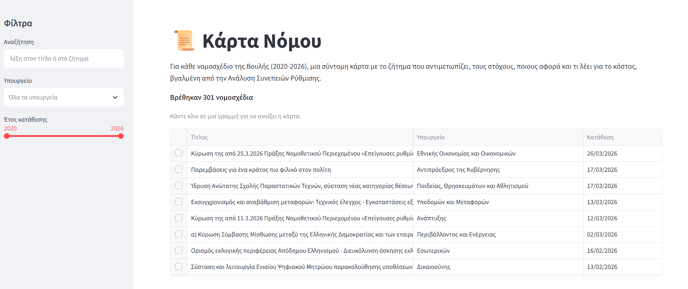
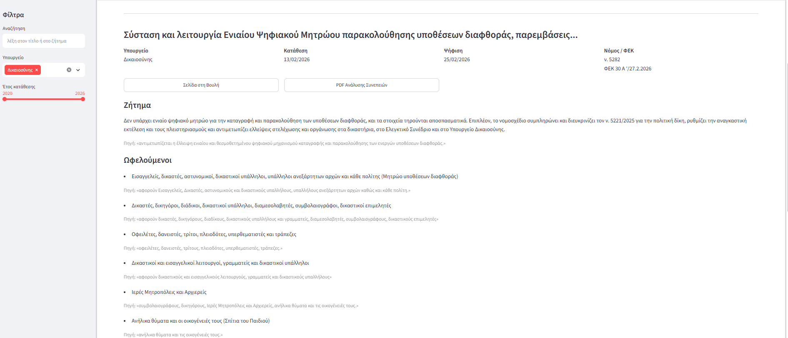
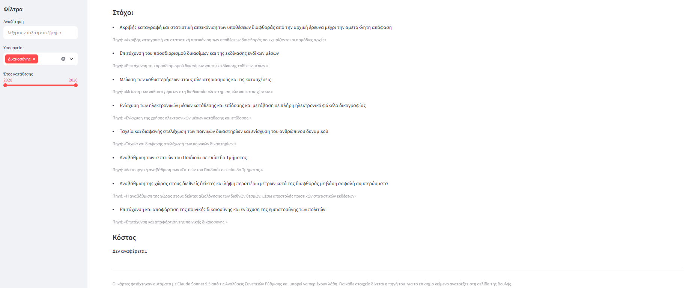

# 📜 Κάρτα Νόμου

Η Κάρτα Νόμου συνοψίζει τα νομοσχέδια της Βουλής των Ελλήνων (2020-2026) σε σύντομες,
κατανοητές «κάρτες». Κάθε κάρτα λέει ποιο ζήτημα αντιμετωπίζει το νομοσχέδιο, ποιους
αφορά, ποιοι είναι οι στόχοι του και τι αναφέρει για το κόστος. Οι κάρτες συμπληρώθηκαν
αυτόματα από γλωσσικό μοντέλο (LLM) με βάση την επίσημη Ανάλυση Συνεπειών Ρύθμισης κάθε
νομοσχεδίου.

**👉 Εφαρμογή: https://karta-nomou.streamlit.app/**



Εργασία για το μάθημα «Σύγχρονες Διαδικτυακές Υπηρεσίες» (2026-27), θέμα 5:
«Κάρτα Νόμου: Εξαγωγή Δομημένης Γνώσης από Νομοσχέδια».

---

## Περιεχόμενα
1. [Οδηγός χρήσης](#οδηγός-χρήσης)
2. [Δεδομένα](#δεδομένα)
3. [Πώς δουλεύει](#πώς-δουλεύει)
4. [Πώς ξανατρέχει η εξαγωγή](#πώς-ξανατρέχει-η-εξαγωγή)
5. [Αξιολόγηση](#αξιολόγηση)
6. [Περιορισμοί](#περιορισμοί)
7. [Prompts προς τον coding agent](#prompts-προς-τον-coding-agent)

---

## Οδηγός χρήσης

Δεν χρειάζεται λογαριασμός ή εγκατάσταση. Ανοίξτε την
[εφαρμογή](https://karta-nomou.streamlit.app/) σε οποιονδήποτε browser, και σε κινητό.

### 1. Αναζήτηση
Στο πλαίσιο **Αναζήτηση** (αριστερά) γράψτε μία ή περισσότερες λέξεις, π.χ. `νοσοκομεία`
ή `ενέργεια`. Βρίσκονται τα νομοσχέδια που έχουν τις λέξεις στον **τίτλο** ή στο **ζήτημα**
που αντιμετωπίζουν.
- Δεν έχουν σημασία οι τόνοι και τα κεφαλαία: το `νομος` βρίσκει και το «Νόμος».
- Με πολλές λέξεις εμφανίζονται μόνο τα νομοσχέδια που τις έχουν **όλες**.

### 2. Φίλτρα
- **Υπουργείο:** διαλέξτε ένα ή περισσότερα υπουργεία. Αν δεν διαλέξετε κανένα,
  εμφανίζονται όλα.
- **Έτος κατάθεσης:** σύρετε τις δύο άκρες της μπάρας για να ορίσετε ένα εύρος ετών,
  π.χ. 2022-2024.

Τα φίλτρα και η αναζήτηση συνδυάζονται. Πάνω από τη λίστα φαίνεται πόσα νομοσχέδια βρέθηκαν.
Σε κινητό, τα φίλτρα ανοίγουν από το βελάκι πάνω αριστερά.

### 3. Άνοιγμα κάρτας
Κάντε κλικ σε μια γραμμή της λίστας. Η κάρτα εμφανίζεται από κάτω και έχει:

| Ενότητα | Τι δείχνει |
|---|---|
| Στοιχεία | Υπουργείο, ημερομηνίες κατάθεσης και ψήφισης, αριθμός νόμου και ΦΕΚ |
| **Ζήτημα** | Ποιο πρόβλημα αντιμετωπίζει το νομοσχέδιο, σε 2-3 προτάσεις |
| **Ωφελούμενοι** | Φορείς και ομάδες πολιτών που αφορά |
| **Στόχοι** | Τι θέλει να πετύχει |
| **Κόστος** | Τι λέει για δαπάνες ή επιβάρυνση του προϋπολογισμού, ή «Δεν αναφέρεται» |





### 4. Τι σημαίνει η «Πηγή»
Κάτω από κάθε στοιχείο της κάρτας, σε μικρά γκρι γράμματα, υπάρχει η **Πηγή**. Είναι ένα
μικρό απόσπασμα **αυτούσιο** από την Ανάλυση Συνεπειών Ρύθμισης, πάνω στο οποίο στηρίχτηκε
το στοιχείο. Έτσι μπορείτε να ελέγξετε ότι η περίληψη λέει αυτό που λέει και το επίσημο
κείμενο. Η περίληψη είναι γραμμένη σε απλά ελληνικά, ενώ η πηγή είναι η διατύπωση του
επίσημου εγγράφου.

### 5. Σύνδεσμοι στη Βουλή
Κάθε κάρτα έχει δύο κουμπιά:
- **Σελίδα στη Βουλή:** η σελίδα του νομοσχεδίου στο hellenicparliament.gr, με όλα τα
  επίσημα έγγραφα.
- **PDF Ανάλυσης Συνεπειών:** το πλήρες έγγραφο από το οποίο φτιάχτηκε η κάρτα.

> Οι κάρτες είναι βοήθημα για γρήγορη ενημέρωση. Το επίσημο κείμενο είναι πάντα αυτό της Βουλής.

---

## Δεδομένα

- **Πηγή:** το dataset
  [`glossAPI/hellenic-parliament-legislative-work`](https://huggingface.co/datasets/glossAPI/hellenic-parliament-legislative-work)
  στο Hugging Face. Περιέχει 489 εγγραφές, από τον Οκτώβριο 2020 έως τον Μάρτιο 2026, με τα
  μεταδεδομένα κάθε νομοσχεδίου (τίτλος, υπουργείο, ημερομηνίες, αριθμός νόμου/ΦΕΚ,
  σύνδεσμοι). Για κάθε εγγραφή περιέχει και την **Ανάλυση Συνεπειών Ρύθμισης (ΑΣΡ)**
  μετατρεμμένη από PDF σε κείμενο.
- **Επιλογή:** κατόπιν οδηγίας του διδάσκοντα, **αφαιρέθηκαν οι διεθνείς συμβάσεις**
  (171 εγγραφές). Έμειναν **318 νομοσχέδια** (314 «Νόμος» και 4 «Σχέδιο νόμου»).
- **Αποτέλεσμα:** φτιάχτηκαν **301 κάρτες**. Τα υπόλοιπα **17** νομοσχέδια έχουν χαλασμένο
  κείμενο ΑΣΡ, γιατί η μετατροπή από PDF απέτυχε (π.χ. μόνο αριθμοί σελίδων, λάθος
  κωδικοποίηση χαρακτήρων). Από αυτά δεν μπορεί να εξαχθεί τίποτα αξιόπιστα.

Το dataset απαιτεί αποδοχή όρων (gated), γι' αυτό **δεν** περιλαμβάνεται στο repository. Στο
repository υπάρχουν μόνο οι έτοιμες κάρτες:
- [`data/cards_public.parquet`](data/cards_public.parquet): μεταδεδομένα και κάρτες. Αυτό
  διαβάζει η εφαρμογή.
- [`cards.jsonl`](cards.jsonl): η «ακατέργαστη» έξοδος του μοντέλου, μία κάρτα ανά γραμμή.

---

## Πώς δουλεύει

```
 data/bills.parquet  (dataset, 489 νομοσχέδια με το κείμενο της ΑΣΡ)
        │
        ▼
 ┌─────────────────┐   χωρίς AI, ~20 δευτερόλεπτα
 │ extract_core.py │   • αφαιρεί τις διεθνείς συμβάσεις (318 μένουν)
 └────────┬────────┘   • κρατά τις ερωτήσεις 1-8 της ΑΣΡ (ζήτημα, φορείς, στόχοι)
          │            • κρατά τα σχόλια για το κόστος
          ▼
   cores.parquet
          │
          ▼
 ┌──────────────────┐  Claude Sonnet 5.5 μέσω Claude API
 │ extract_cards.py │  • ένα αίτημα ανά νομοσχέδιο
 └────────┬─────────┘  • tool use με αυστηρό (strict) JSON schema
          │            • κάθε στοιχείο συνοδεύεται από αυτούσια πηγή
          ▼
    cards.jsonl  (301 κάρτες)
          │
          ▼
 ┌─────────────────┐   ενώνει κάρτες + μεταδεδομένα,
 │ build_public.py │   χωρίς το κείμενο του dataset
 └────────┬────────┘
          ▼
 data/cards_public.parquet  (~850 KB)
          │
          ▼
 ┌─────────────────┐   εφαρμογή Streamlit, δεν καλεί το LLM
 │     app.py      │   → https://karta-nomou.streamlit.app/
 └─────────────────┘
```

### Τα βήματα αναλυτικά

**1. Αποκοπή ([`extract_core.py`](extract_core.py)).** Οι ΑΣΡ ακολουθούν σταθερό πρότυπο
ερωτήσεων: «1. Ποιο ζήτημα αντιμετωπίζει…», «2. Γιατί αποτελεί πρόβλημα;», «3. Ποιους
φορείς ή πληθυσμιακές ομάδες αφορά;» … «8. Ποιοι είναι οι στόχοι…». Το script κόβει αυτό το
τμήμα με κανονικές εκφράσεις (regex), γιατί τα πλήρη κείμενα είναι πολύ μεγάλα (διάμεσος
~124 χιλ. χαρακτήρες, έως 20 εκατ. λόγω σχολίων διαβούλευσης). Για το κόστος κρατά το
κείμενο «Σχολιασμός / ποιοτική αποτίμηση» κάτω από τον πίνακα κόστους, καθώς και φράσεις
όπως «δεν προκαλείται δαπάνη σε βάρος του κρατικού προϋπολογισμού». Το φίλτρο τύπων
βρίσκεται σε ένα σημείο, στη σταθερά `EXCLUDE_TYPES`.

**2. Εξαγωγή κάρτας ([`extract_cards.py`](extract_cards.py)).** Για κάθε νομοσχέδιο στέλνεται
στο Claude Sonnet 5.5 το κομμένο κείμενο μαζί με οδηγίες: μόνο πληροφορίες από το κείμενο,
απλά ελληνικά, αυτούσια πηγή για κάθε στοιχείο, «Δεν αναφέρεται» όπου κάτι λείπει. Το
μοντέλο απαντά καλώντας το εργαλείο `save_card`, που έχει σταθερό JSON schema με
`strict: true`. Έτσι κάθε κάρτα έχει ακριβώς τα ίδια πεδία:

```
readable, issue, issue_evidence,
beneficiaries[ {group, evidence} ],  goals[ {goal, evidence} ],
cost {mentioned, summary, amount, evidence}
```

Αν μια απάντηση είναι ημιτελής, δεν αποθηκεύεται και ξαναδοκιμάζεται στο επόμενο τρέξιμο.
Το script συνεχίζει από όπου σταμάτησε.

**3. Δημόσιο αρχείο ([`build_public.py`](build_public.py)).** Ενώνει τις κάρτες με τα
μεταδεδομένα και ξεχωρίζει τον αριθμό νόμου και το ΦΕΚ. Γράφει ένα μικρό αρχείο χωρίς το
κείμενο του dataset.

**4. Εφαρμογή ([`app.py`](app.py)).** Εφαρμογή [Streamlit](https://streamlit.io) που διαβάζει
το έτοιμο αρχείο. Δεν καλεί το LLM, άρα δεν έχει κόστος λειτουργίας και δεν χρειάζεται κλειδί
API. Φιλοξενείται δωρεάν στο Streamlit Community Cloud, απευθείας από αυτό το repository.

---

## Πώς ξανατρέχει η εξαγωγή

Χρειάζεστε Python 3.10 ή νεότερη και, για το βήμα 3, κλειδί για το
[Claude API](https://platform.claude.com/). Οι εντολές είναι για Windows PowerShell.

**1. Λήψη κώδικα και εγκατάσταση**
```powershell
git clone https://github.com/egiduro54-png/karta-nomou.git
cd karta-nomou
pip install -r requirements.txt           # η εφαρμογή (streamlit, pandas, pyarrow)
pip install -r requirements-extract.txt   # τα scripts εξαγωγής και αξιολόγησης (+ anthropic, openpyxl)
```
Υπάρχουν δύο αρχεία βιβλιοθηκών. Το `requirements.txt` το διαβάζει το Streamlit Community
Cloud, γι' αυτό περιέχει μόνο ό,τι χρειάζεται η εφαρμογή, με κλειδωμένες τις εκδόσεις του
Streamlit και του pyarrow (η 26.0.1 έχει γνωστό segfault στο Streamlit Cloud). Αν θέλετε μόνο
να τρέξετε την εφαρμογή τοπικά, αρκεί το πρώτο.

**2. Dataset.** Συνδεθείτε στο Hugging Face, αποδεχτείτε τους όρους στη
[σελίδα του dataset](https://huggingface.co/datasets/glossAPI/hellenic-parliament-legislative-work)
και αποθηκεύστε το αρχείο ως `data/bills.parquet`. Μετά τρέξτε:
```powershell
python extract_core.py data/bills.parquet      # -> cores.parquet
```

**3. Κλειδί API.** Ορίζεται μόνο στο τρέχον τερματικό και **ποτέ** δεν γράφεται σε αρχείο:
```powershell
$env:ANTHROPIC_API_KEY="sk-ant-..."
```

**4. Κάρτες**
```powershell
python extract_cards.py --dry-run --sample 1   # δείχνει το prompt, χωρίς κλήση API και χωρίς κόστος
python extract_cards.py --sample 5             # δοκιμή σε 5 νομοσχέδια
python extract_cards.py --all                  # όλα (αν διακοπεί, συνεχίζει από όπου σταμάτησε)
```
Χρήσιμες επιλογές:
- `--model claude-haiku-5-5 --out cards_haiku.jsonl`: άλλο μοντέλο, για σύγκριση.
- `--ids <law_id>,<law_id>`: μόνο συγκεκριμένα νομοσχέδια.

Για να ξαναγίνει μια κάρτα, σβήστε τη γραμμή της από το `cards.jsonl` και ξανατρέξτε.

**5. Δημόσιο αρχείο και εφαρμογή**
```powershell
python build_public.py                         # -> data/cards_public.parquet
streamlit run app.py                           # ανοίγει στο http://localhost:8501
```

---

## Αξιολόγηση

Ελέγξαμε χειροκίνητα **20 κάρτες**, επιλεγμένες τυχαία (σταθερό seed = 42) και από 20
διαφορετικά υπουργεία. Κάθε στοιχείο της κάρτας συγκρίθηκε με την Ανάλυση Συνεπειών Ρύθμισης.

**Κριτήριο.** Ένα στοιχείο θεωρείται **σωστό** όταν αποδίδει την ουσία της ΑΣΡ, ακόμη και
με γενικότερη διατύπωση. Στο κόστος, η απουσία ποσού είναι σωστή όταν η ΑΣΡ δεν δίνει ποσό.
Το Ζήτημα και το Κόστος βαθμολογήθηκαν ως Σωστό, Μερικώς σωστό ή Λάθος. Στους Ωφελούμενους
και στους Στόχους μετρήθηκε πόσα από τα στοιχεία της λίστας είναι σωστά και αν λείπει κάτι
σημαντικό.

| Πεδίο | Αποτέλεσμα | Ποσοστό σωστών |
|---|---|---|
| Ζήτημα | 20 σωστά από 20 | **100%** |
| Κόστος | 17 σωστά, 3 μερικώς σωστά, 0 λάθος | **85%** |
| Ωφελούμενοι | 100 σωστά στοιχεία από 106· λείπει κάτι σημαντικό σε 7 από τις 20 κάρτες | **94,3%** |
| Στόχοι | 118 σωστά στοιχεία από 131· λείπει κάτι σημαντικό σε 4 από τις 20 κάρτες | **90,1%** |
| **Συνολικά** | **255 σωστά στοιχεία από 277** | **92,1%** |

Το συνολικό ποσοστό είναι **αυστηρό**: τα «μερικώς σωστά» δεν μετρούν ως σωστά. Κάθε
ζήτημα, κόστος, ωφελούμενος και στόχος μετρά ως ένα στοιχείο.

**Αυτόματος έλεγχος τεκμηρίων.** Ελέγξαμε επίσης αυτόματα αν κάθε «Πηγή» υπάρχει αυτούσια
στο κείμενο της ΑΣΡ, αγνοώντας κενά, στίξη, τόνους και κεφαλαία. Βρέθηκαν **243 από τα 266
τεκμήρια (91,4%)**. Όσα δεν βρέθηκαν αυτούσια έχουν πάνω από το 92% των λέξεών τους στο
κείμενο. Οφείλονται κυρίως σε λάθη OCR του PDF, τα οποία το μοντέλο διόρθωσε όταν αντέγραψε
το απόσπασμα. Κανένα από αυτά δεν φαίνεται επινοημένο.

**Παρατήρηση.** Το μοντέλο εντοπίζει πάντα το βασικό ζήτημα του νομοσχεδίου, αλλά συχνά
προσθέτει και δευτερεύουσες ρυθμίσεις.

**Αρχεία:** το φύλλο της αξιολόγησης με όλους τους βαθμούς και τα σχόλια είναι το
[`evaluation/aksiologisi_public.xlsx`](evaluation/aksiologisi_public.xlsx). Από αυτό έχει
αφαιρεθεί η στήλη με το πλήρες κείμενο της ΑΣΡ, γιατί το dataset είναι gated. Το φύλλο το
δημιουργεί το [`evaluation/make_sheet.py`](evaluation/make_sheet.py) και το δημόσιο αντίγραφο
το [`evaluation/make_public.py`](evaluation/make_public.py).

---

## Περιορισμοί

- **Το κόστος δεν δίνεται ως ποσό.** Τα ποσά υπάρχουν συνήθως στην Έκθεση του Γενικού
  Λογιστηρίου του Κράτους (άρθρο 75 παρ. 3 του Συντάγματος). Αυτή είναι ξεχωριστό PDF και
  δεν περιλαμβάνεται στο dataset. Η ΑΣΡ συνήθως παραπέμπει σε αυτήν («Βλ. συνημμένες
  εκθέσεις»). Γι' αυτό το πεδίο «Κόστος» είναι **ποιοτικό**: λέει π.χ. αν προκαλείται
  δαπάνη και από πού καλύπτεται. Σε πολλές κάρτες γράφει «Δεν αναφέρεται». Κείμενο για το
  κόστος βρέθηκε σε περίπου τα μισά νομοσχέδια.
- **Το LLM μπορεί να κάνει λάθη.** Μπορεί να παραλείψει ωφελούμενους ή στόχους, να
  συνοψίσει ανακριβώς ή, σπανιότερα, να γράψει κάτι που δεν στηρίζεται στο κείμενο. Η
  «Πηγή» κάτω από κάθε στοιχείο υπάρχει ακριβώς για να ελέγχεται αυτό.
- **Η κάρτα βασίζεται μόνο στην ΑΣΡ**, όχι στο ίδιο το κείμενο του νόμου. Αλλαγές που
  έγιναν στη Βουλή μετά την κατάθεση, π.χ. τροπολογίες, δεν αποτυπώνονται.
- **Χαλασμένα κείμενα:** 17 νομοσχέδια δεν έχουν κάρτα, γιατί η μετατροπή του PDF της ΑΣΡ σε
  κείμενο απέτυχε.
- **Χρονικό εύρος:** μόνο ό,τι περιέχει το dataset (Οκτώβριος 2020 έως Μάρτιος 2026).

---

## Prompts προς τον coding agent

Ο κώδικας γράφτηκε με τη βοήθεια του Claude (claude.ai και Claude Code στο VS Code). Τα
βασικά prompts που δόθηκαν, με μία γραμμή για το αποτέλεσμα του καθενός, καταγράφονται στο
**[docs/PROMPTS.md](docs/PROMPTS.md)**.

## Αρχεία

| Αρχείο | Ρόλος |
|---|---|
| [`app.py`](app.py) | Η εφαρμογή Streamlit |
| [`extract_core.py`](extract_core.py) | Βήμα 1: αποκοπή των χρήσιμων τμημάτων της ΑΣΡ |
| [`extract_cards.py`](extract_cards.py) | Βήμα 2: εξαγωγή κάρτας με το Claude API |
| [`build_public.py`](build_public.py) | Βήμα 3: το αρχείο που διαβάζει η εφαρμογή |
| [`data/cards_public.parquet`](data/cards_public.parquet) | Οι κάρτες με τα μεταδεδομένα |
| [`cards.jsonl`](cards.jsonl) | Η ακατέργαστη έξοδος του μοντέλου |
| [`evaluation/`](evaluation/) | Η χειροκίνητη αξιολόγηση των 20 καρτών |
| [`docs/PROMPTS.md`](docs/PROMPTS.md) | Τα prompts προς τον coding agent |
| [`requirements.txt`](requirements.txt) | Οι βιβλιοθήκες της εφαρμογής (τις διαβάζει το Streamlit Cloud) |
| [`requirements-extract.txt`](requirements-extract.txt) | Οι βιβλιοθήκες για τα scripts εξαγωγής και αξιολόγησης |
